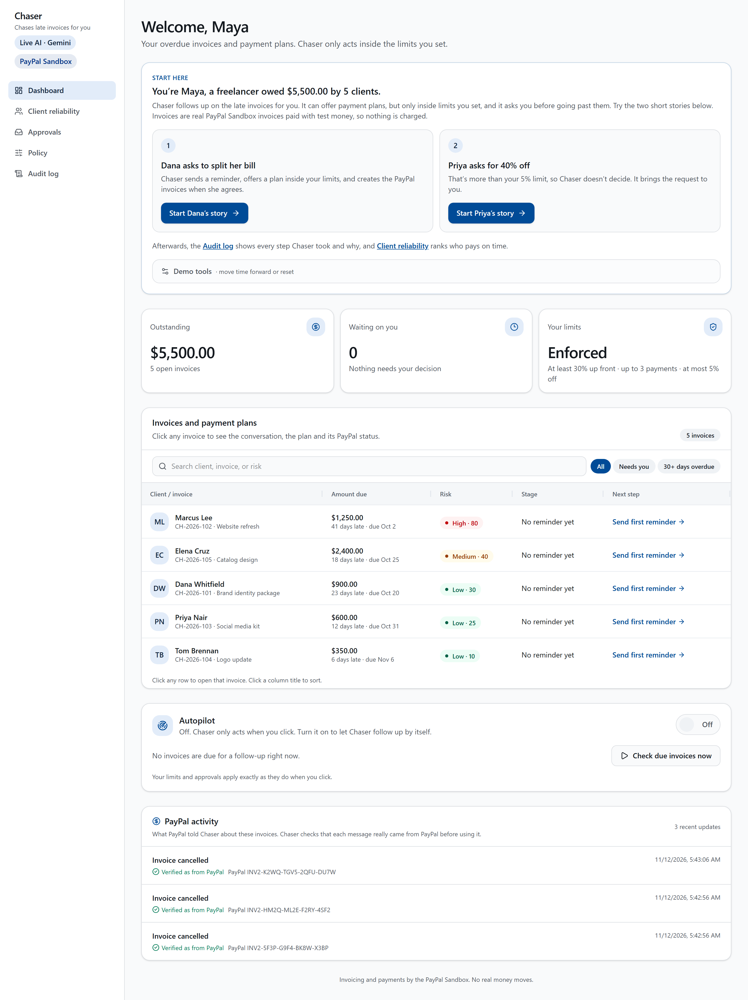
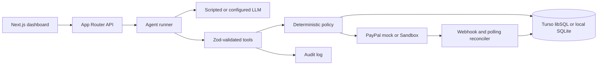

# Chaser

Chaser is an AI collections agent for freelancers and micro-businesses: it follows up on overdue PayPal invoices, proposes payment plans inside owner-defined limits, creates installment invoices, and leaves an auditable trail of every decision. The project is designed around a deterministic safety boundary: the language model may propose an action, but validated tools and policy code decide whether money-moving work is allowed.



See [Dana before negotiation](docs/screenshots/dana-before.png), the [issued plan and PayPal panel](docs/screenshots/invoice-paypal.png), [PayPal activity](docs/screenshots/paypal-activity.png), the [approvals inbox](docs/screenshots/approvals.png), and the [audit log](docs/screenshots/audit.png). These screenshots use local mock PayPal, including the test webhook in the activity feed.

## What is here

- A risk-ranked dashboard for five fictional overdue invoices.
- A private [client reliability ranking](docs/screenshots/client-reliability.png) with a breakdown of payment timing, installment adherence, recorded discount escalations, and overdue exposure. The public demo shows the fictional clients.
- **Autopilot**: an owner switch that lets Chaser sweep due invoices every 30 minutes (GitHub Actions cron plus a shared secret) or on demand, within the same policy and approval rules. Off by default.
- **Owner alerts**: when the agent needs a decision, Chaser emails the owner through Resend with a link to Approvals, and records the attempt in the audit log.
- **Reply as the client** (live AI only): type any client message on an invoice; the model classifies it as untrusted text and the bounded agent answers within policy. The guided Dana and Priya steps stay scripted so the walkthrough is repeatable.
- Sortable, searchable **AG Grid** tables on the dashboard and the client ranking, with a plain-language audit log that keeps every raw record one click away.
- A guided Dana negotiation that demonstrates a 30% deposit and two remainder installments.
- Deterministic policy limits, owner approvals for out-of-bounds requests, and an audit log.
- PayPal Invoicing v2 integration with a mock provider for offline demos and a Sandbox provider for configured test accounts.
- A PayPal panel with stored invoice IDs and recipient links when available, installment amounts and statuses, and a dashboard activity feed for received webhooks. Webhooks and polling reconcile invoice state.
- Scripted client replies for a repeatable demo, with an adapter for a configured live LLM.
- Better Auth owner setup for private deployments. Public demo mode bypasses the auth gate for the fictional workspace.

## Architecture



The safety pipeline is: **LLM proposes → Zod validates → policy engine decides → effect + audit**. Client text is delimited as untrusted data, and an out-of-bounds or unclear request goes to the approval inbox instead of changing policy.

## Stack

Next.js App Router, TypeScript, React, Tailwind, Zod, Drizzle, Vitest, Better Auth, and direct PayPal REST calls. Hosted persistence uses Turso/libSQL when both Turso variables are configured; local development and tests use a SQLite file through `better-sqlite3`. The public demo is hosted on Render (`render.yaml`), and owner sign-in email goes through Resend.

## Quick start (mock mode, no keys)

Node.js 22 and pnpm 10 are recommended. From a clean clone:

```sh
pnpm install --frozen-lockfile
node -e "require('node:fs').writeFileSync('.env.local','DATABASE_PATH=./data/chaser.db\nDEMO_PUBLIC=1\nPAYPAL_MODE=mock\nLLM_MODE=scripted\n',{flag:'wx'})"
pnpm db:push
pnpm auth:migrate
pnpm db:seed-if-empty
pnpm dev
```

Open [http://localhost:3000](http://localhost:3000). The seeded story is Maya Rahman's fictional workspace: five overdue invoices totaling $5,500. Mock PayPal creates fake invoice IDs and simulated payments; no money or PayPal account is used. The guided client conversation is simulated in the UI, not sent by email or SMS.

For the real PayPal Sandbox client, configure the non-secret settings and credentials outside the repository, then follow [docs/runbook.md](docs/runbook.md). Keep `PAYPAL_MODE=sandbox`; never use a live PayPal URL. The Sandbox path is test money only and requires a configured Sandbox app and buyer account.

Run the scripted guardrail suite with:

```sh
pnpm test:evals
pnpm test
```

The scripted suite checks policy, tool validation, client-text wrapping, arithmetic, idempotency, tone, and audit behavior. It is not a measurement of model quality. `pnpm test:evals -- --live` uses a configured provider key when one is present.

## Project structure

- `src/app/` — pages and thin App Router route handlers
- `src/components/` — dashboard, guided demo, approvals, and shared UI
- `src/lib/agent/` — bounded agent runner and tools
- `src/lib/policy/` — deterministic money and negotiation rules
- `src/lib/paypal/` — mock and Sandbox clients, webhooks, and reconciliation
- `src/lib/db/` — schema, queries, migrations, and fictional seed data
- `src/evals/` — declarative scripted and optional live evaluation harness
- `docs/` — product, safety, demo, runbook, and submission material

## Honest limitations

Client messaging is a simulated conversation. The default quick start uses mock money; a Sandbox deployment uses PayPal test accounts, not live funds. The live LLM path is optional and can vary by provider; scripted mode is used when no provider key is configured. The hosted demo uses free-tier infrastructure, so the first request can take about a minute while the service wakes. This is a single-owner demo, not a multi-tenant collections product.

## Try it

Open the hosted [Chaser demo](https://paypal-ai-hackathon-9tkr.onrender.com). It runs **PayPal Sandbox** with fictional data and no Chaser login. Allow about a minute for Render Free to wake after idle time. The local `pnpm dev` quick start runs **mock PayPal** without credentials. Owner authentication is available for private deployments.

In the hosted Dana walkthrough, the guided replies are scripted. Once the plan is issued, the installment list shows the Sandbox invoice IDs and stored **Open in PayPal** links. The **PayPal activity** card lists webhook deliveries the app has received. A Sandbox buyer payment is optional. See the [judge walkthrough](docs/devpost.md#test-the-demo).

Sandbox buyer credentials for judges are in the Devpost testing instructions.

## What’s next

Cross-freelancer reliability pooling would need minimum sample sizes and a way for clients to dispute records.

## License

Distributed under the [MIT License](LICENSE). Source code is on [GitHub](https://github.com/sheikh2583/Paypal-AI-Hackathon).
